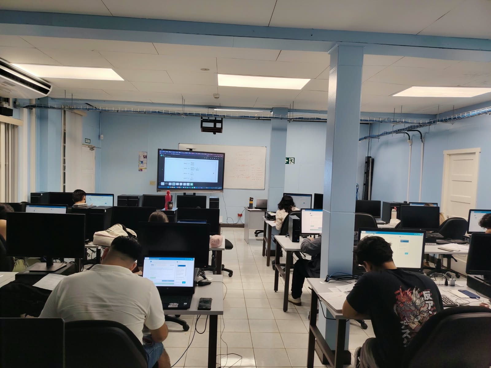
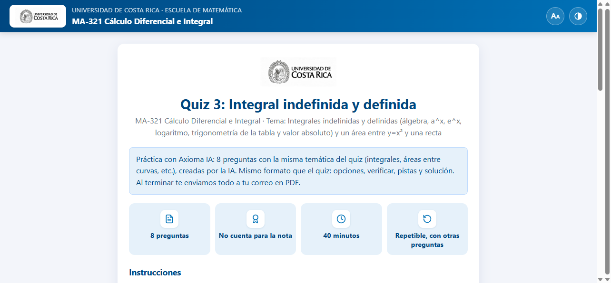
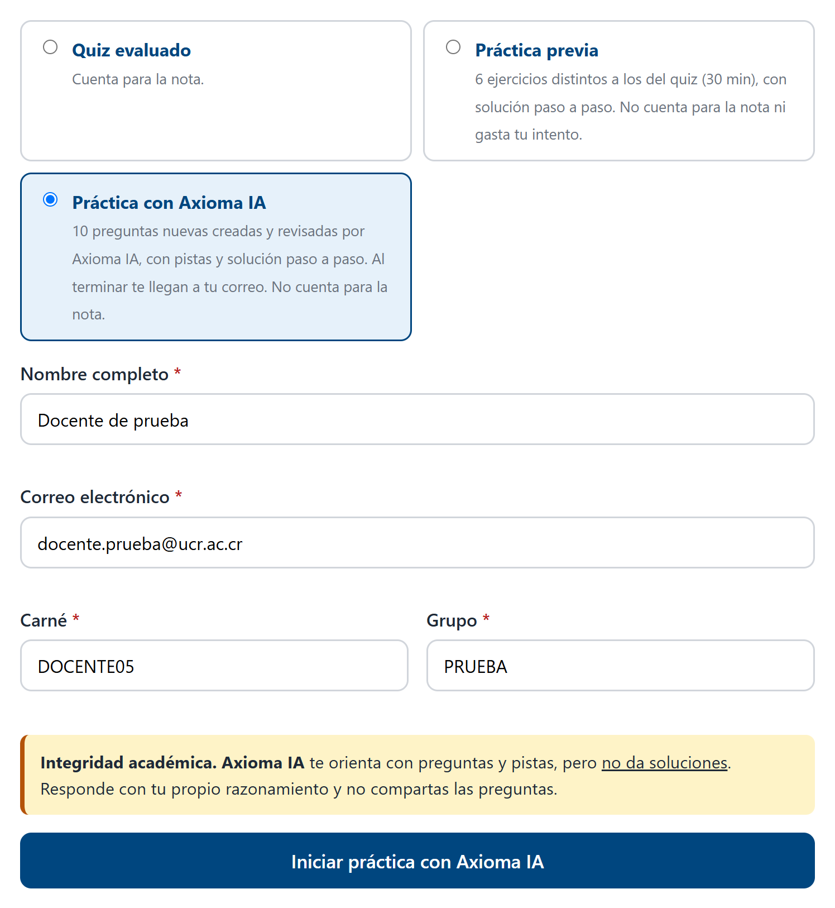
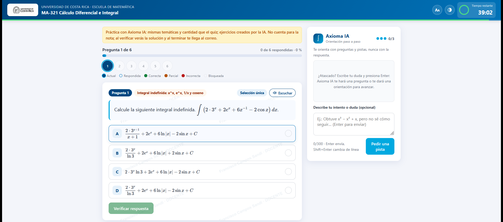
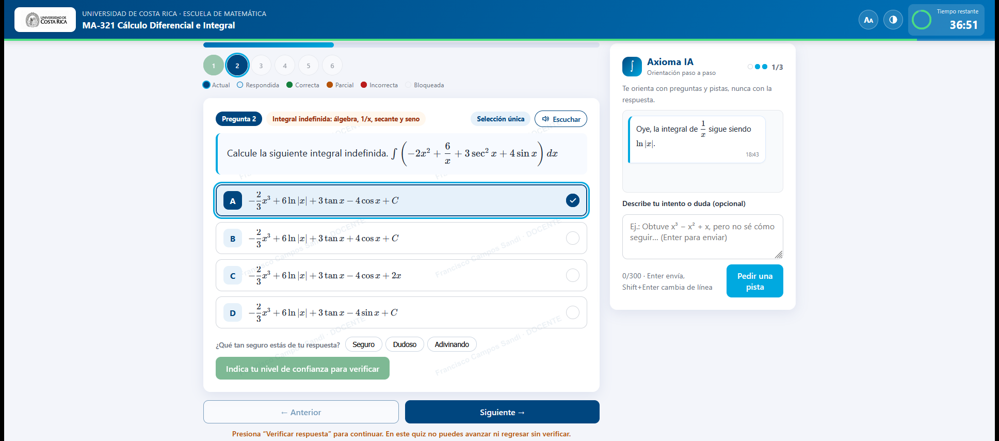
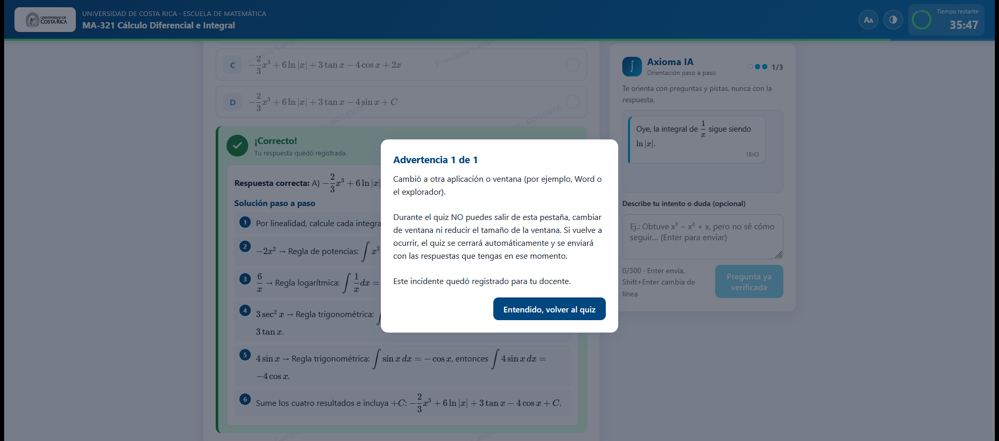

# Quiz de Cálculo MA-321 con Axioma IA

Aplicación web educativa para apoyar la práctica y evaluación de temas de cálculo
diferencial e integral. Integra un cuestionario con un tutor de IA llamado
Axioma, que ofrece orientación durante la práctica.

## Qué se desarrolló

- Cuestionario web para resolver ejercicios de cálculo.
- Modo de práctica separado del intento evaluado.
- Tutor Axioma IA con pistas y orientación para el aprendizaje.
- Registro de resultados mediante Google Apps Script y Google Sheets.
- Interfaz web construida con HTML, CSS y JavaScript.

## Evidencias

[Ver video de demostración](./evidencias/video-demostracion.mp4)

## Así se ve el quiz

| | |
|---|---|
|  |  |
| **1. Portada:** tema, número de preguntas y tiempo | **2. Ingreso:** quiz evaluado, práctica previa o práctica con Axioma IA |
|  |  |
| **3. Pregunta:** opciones con notación matemática y tutor Axioma IA | **4. Confianza y pista:** el estudiante indica su seguridad y recibe orientación |

**5. Solución paso a paso** al verificar la respuesta y advertencia de integridad
al salir de la pestaña.

Las capturas usan datos de prueba (usuario de práctica, no estudiantes reales).

## Documento de planificación

[FRANCISCO_CAMPOS_SEDE_SUR.pdf](./FRANCISCO_CAMPOS_SEDE_SUR.pdf): planificación
de la evaluación (43 páginas) que resume el diseño pedagógico, el
funcionamiento de la aplicación y sus resultados.

## Código

Carpeta [codigo](./codigo/):

| Archivo | Contenido |
|---|---|
| `Código.gs` | Servidor: banco de preguntas, calificación, tutor Axioma IA y registro en Sheets |
| `Index.html` | Estructura de la interfaz |
| `JavaScript.html` | Lógica del navegador |
| `CSS.html` | Estilos |

## Tecnologías

Google Apps Script, Google Sheets, HTML, CSS, JavaScript y un servicio de IA
compatible con la API de OpenAI.

## Configuración

Para ejecutar el proyecto, copia los cuatro archivos al editor de Apps Script y
completa en `CONFIG` el `SPREADSHEET_ID` y los datos de contacto. Las claves de
la API se agregan desde el menú «Agregar claves de API (NVIDIA)», que las
guarda en Script Properties; nunca se deben escribir en el código.

## Alcance de esta carpeta

El código se publica sin claves API, sin identificadores de hojas ni enlaces a
despliegues activos, y con los datos de simulación anonimizados (E01–E10). El
PDF conserva el enlace y el código QR de la aplicación; solo se omitió el correo
personal.

Antes de hacer públicas las evidencias, confirma que tienes autorización para
compartir la imagen y el audio/video de todas las personas que aparezcan.
